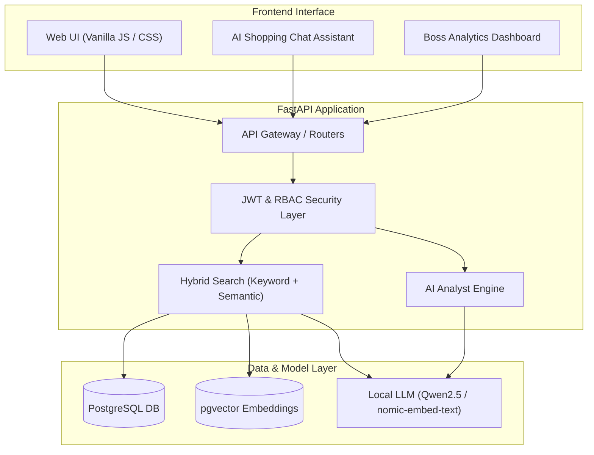

# 🛍️ AI Clothing Store

[](https://github.com/Az1zbekx/ai-clothing-store/actions/workflows/ci.yml)
[](https://opensource.org/licenses/MIT)


> **Next-generation intelligent e-commerce platform built with FastAPI, PostgreSQL (`pgvector`), and Local LLMs (Ollama / Qwen2.5).**

---

## 🌟 Overview

**AI Clothing Store** is a modern e-commerce platform that replaces tedious menu filtering with an interactive conversational shopping assistant and a real-time semantic search engine.

Customers can converse with an AI shopping assistant in natural language to discover apparel by color, season, cut, and fit. Concurrently, business operators have access to an executive **Boss Dashboard** featuring an AI business analyst that delivers live revenue telemetry, inventory anomaly detection, and operational recommendations.



---

## 🚀 Key Features

* **💬 Conversational AI Shopping:** Natural language product discovery for style, occasion, size, and material.
* **🔍 Hybrid Search Engine:** Blends exact keyword filtering with high-dimensional vector similarity (`pgvector` with `nomic-embed-text` embeddings).
* **📊 Boss Analytics Dashboard:** Live sales tracking, revenue calculation, and inventory alerts.
* **👨‍💼 Executive AI Business Analyst:** On-demand AI business intelligence (e.g., bestsellers, stock replenishment needs, revenue trends).
* **🔒 Local Privacy-Preserving AI:** Operates locally via Ollama (`qwen2.5:1.5b`) ensuring zero vendor API latency, high data privacy, and minimal hosting costs.
* **🛡️ Role-Based Access Control (RBAC):** JWT authentication distinguishing regular customers, admins, and executive store owners.

---

## 🛠️ Technology Stack

| Layer | Technology |
|---|---|
| **Backend Framework** | [FastAPI](https://fastapi.tiangolo.com/) (Python 3.11) |
| **Relational Database** | [PostgreSQL](https://www.postgresql.org/) with [SQLAlchemy 2.0](https://www.sqlalchemy.org/) |
| **Vector Search Extension** | [pgvector](https://github.com/pgvector/pgvector) |
| **Local AI Runtime** | [Ollama](https://ollama.com/) (`qwen2.5:1.5b` + `nomic-embed-text`) |
| **Authentication** | OAuth2 Password Bearer with JWT (`python-jose`, `passlib`, `bcrypt`) |
| **Frontend** | Vanilla HTML5, CSS3 Glassmorphism, Modern JavaScript (Fetch API) |
| **CI / Automation** | GitHub Actions |

---

## ⚙️ Installation & Setup

### Prerequisites
1. **Python 3.9+**
2. **PostgreSQL** with the `pgvector` extension installed.
3. **Ollama** installed locally ([ollama.com](https://ollama.com/)).

### 1. Database Setup
```sql
CREATE DATABASE ai_clothing_store;
\c ai_clothing_store
CREATE EXTENSION vector;
```

### 2. Pull Local AI Models
```bash
ollama pull qwen2.5:1.5b
ollama pull nomic-embed-text
```

### 3. Backend Setup
```bash
# Clone the repository
git clone https://github.com/Az1zbekx/ai-clothing-store.git
cd ai-clothing-store/backend

# Create virtual environment
python3 -m venv venv
source venv/bin/activate  # On Windows: venv\Scriptsctivate

# Install dependencies
pip install -r requirements.txt

# Configure environment variables
cp .env.example .env
# Edit .env with your PostgreSQL credentials
```

### 4. Run Development Server
```bash
uvicorn app.main:app --reload --port 8000
```

Access the interactive API documentation at `http://localhost:8000/docs`.  
Open `frontend/customer.html` or `frontend/boss-dashboard.html` in your browser.

---

## 🔑 Demo Access Credentials

| Role | Username | Password | Accessible Interfaces |
|---|---|---|---|
| **Administrator** | `admin` | `1234` | Product Catalog Management, Stock Updates |
| **Store Executive (Boss)** | `boss` | `1234` | Executive Dashboard, Sales Analytics, AI Analyst |
| **Customer** | Self-registered | — | Conversational Shopping Assistant, Order History |

---

## 📄 License
This project is open-source software licensed under the [MIT License](LICENSE).
